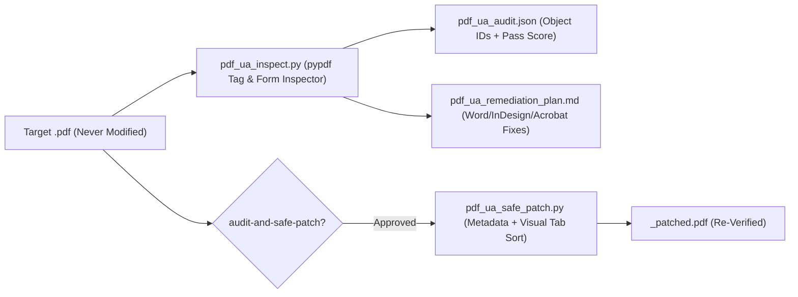

# pdf-ua-preflight-remediator

[](https://skills.sh/ameer-agent-dev/pdf-ua-preflight-remediator/pdf-ua-preflight-remediator)
[](https://github.com/ameer-agent-dev/pdf-ua-preflight-remediator)
[](https://agentskills.io/specification)
[](scripts/)
[](SKILL.md)
[](LICENSE)

**Live on skills.sh:** [skills.sh/ameer-agent-dev/pdf-ua-preflight-remediator/pdf-ua-preflight-remediator](https://skills.sh/ameer-agent-dev/pdf-ua-preflight-remediator/pdf-ua-preflight-remediator)

Inspect PDF documents and interactive AcroForms deterministically in pure Python for **PDF/UA-1 (ISO 14289-1), WCAG 2.1 AA, and Section 508** accessibility defects, optionally generate a non-destructive safe-patched copy (`<stem>_patched.pdf`), and deliver a page-and-object-ID remediation blueprint.

Built on the [Open Agent Skills specification](https://agentskills.io/specification) with zero-config `skills.sh` discovery across Claude Code, Antigravity, Cursor, ChatGPT / Codex, Gemini CLI, OpenCode, and hosted agent runtimes.

---

## Quick Install

Open on [skills.sh](https://skills.sh/ameer-agent-dev/pdf-ua-preflight-remediator/pdf-ua-preflight-remediator) to inspect or prompt your AI coding agent directly:

```text
Install the pdf-ua-preflight-remediator Agent Skill from https://skills.sh/ameer-agent-dev/pdf-ua-preflight-remediator/pdf-ua-preflight-remediator
```

Install directly via the `skills` CLI (explicit skill flag):

```bash
npx skills add ameer-agent-dev/pdf-ua-preflight-remediator --skill pdf-ua-preflight-remediator
```

Preview discovered metadata or install via single-repo shorthand:

```bash
npx skills add ameer-agent-dev/pdf-ua-preflight-remediator --list
npx skills add ameer-agent-dev/pdf-ua-preflight-remediator
```

---

## Why This Skill Exists & Who It Is For

Public-sector deadlines (ADA Title II, Section 508, EN 301 549) routinely stall when **PAC 2026 freezes mid-check on duplicate `/MCID` entries**, **exported PDFs lack `/StructTreeRoot` or XMP `dc:title`**, or **multi-column AcroForms trap keyboard users in scrambled `/Annots` tab orders**.

Built for:
- **Digital Accessibility Specialists & Document Remediators** debugging PAC 2026 and Adobe Acrobat Accessibility Checker errors.
- **Government, Higher-Ed & Healthcare Publishing Teams** shipping Section 508 and WCAG 2.1 AA compliant public forms and reports.
- **CI / Publishing Engineers** running offline pre-flight checks on Word, InDesign, and PDF pipelines without Acrobat Pro licenses.

## Key Capabilities

- **PAC 2026 crash root-cause pinpoint**: Walks `/StructTreeRoot` to isolate exact page numbers and PDF object IDs (`12 0 R`) with duplicate per-page `/MCID` integers.
- **Tag-tree & semantic structure audit**: Flags untagged PDFs (`CRITICAL_UNTAGGED_PDF`), image-only scans (`SCANNED_IMAGE_PDF`), skipped heading levels (`H1 -> H3`), `<Figure>` tags missing `/Alt`, and `<Table>` tags missing `<TH>` header cells.
- **Deterministic AcroForm geometry sorting**: Clusters form `/Widget` bounding boxes `[x0, y0, x1, y1]` into visual reading order (`rows` within 10pt Y-tolerance or `columns`) and flags missing `/TU` tooltips or missing `/Tabs /S`.
- **Non-destructive safe patcher**: Writes `<stem>_patched.pdf` (guarded by path + SHA-256 verification) fixing `/Catalog/Lang`, `/Info/Title` + XMP `dc:title`, `DisplayDocTitle true`, `/Tabs /S`, and `/Annots` tab order without ever touching the source PDF.

---

## Architecture & Workflow



---

## Repository Layout

```text
./
├── SKILL.md                                 # Canonical Agent Skill specification, gates, and workflow
├── README.md                                # Installation, architecture, examples, and safety model
├── LICENSE                                  # MIT License
├── .gitignore                               # Workdir, bytecode, virtualenv, and env exclusions
├── scripts/
│   ├── pdf_ua_inspect.py                    # Catalog, StructTreeRoot, MCID, figure/table & widget inspector
│   └── pdf_ua_safe_patch.py                 # Non-destructive metadata, XMP dc:title & widget order patcher
├── references/
│   ├── pdf_ua_matterhorn_checks.md          # Matterhorn Protocol 1.1, PDF/UA-1, WCAG & 508 mapping
│   └── indesign_word_export_fixes.md        # Source-level Word, InDesign, and Acrobat Pro remediation steps
└── assets/
    └── remediation_report_template.md       # Customizable Markdown blueprint template
```

---

## Inputs & Expected Deliverables

### Inputs

| Input | Requirement | Default / Options |
| :--- | :--- | :--- |
| **Target PDF Path** | **Mandatory** | Local `.pdf` file (aborts cleanly with exit code `3` if password-encrypted) |
| **Target Standard** (`--standard`) | Optional | `PDF/UA-1` (default), `WCAG 2.1 AA`, or `Section 508` |
| **Execution Mode** | Optional | `audit-only` (default) or `audit-and-safe-patch` |
| **Document Language** (`--lang`) | Optional | BCP-47 tag (e.g., `en-US`; prompted once in patch mode if `/Lang` is absent) |
| **Widget Layout** (`--layout`) | Optional | `rows` (default, `10.0` pt Y-tolerance) or `columns` |

### Expected Output Files

| Deliverable | Description |
| :--- | :--- |
| `pdf_ua_audit.json` | Complete machine-readable inspection (`is_tagged`, `banners`, `metadata_checks`, `duplicate_mcids`, `heading_skips`, `missing_alt_figures`, `table_header_issues`, `form_tab_order_mismatches`, `pass_score_pct`) |
| `pdf_ua_remediation_plan.md` | Page-by-page Critical/High/Medium table with PDF object IDs, Word/InDesign vs. Acrobat fix instructions, and screen-reader sign-off notice |
| `<stem>_patched.pdf` | Generated **only** in `audit-and-safe-patch` mode with metadata and visual AcroForm tab order applied |

---

## Example Prompts

**Pre-Flight Audit + Non-Destructive Form Tab-Order & Metadata Patch:**

```text
Run a PDF/UA-1 preflight audit and safe patch on ./benefit_enrollment_form.pdf with language "en-US", title "2026 Employee Benefit Enrollment Form", and row-first widget tab order, then re-verify the patched copy.
```

**Edge Case (Debugging PAC 2026 MCID Freeze on Large Report):**

```text
PAC 2026 hangs with an "MCID already present" error on ./annual_financial_report.pdf. Run an audit-only inspection, list the exact page numbers and PDF object IDs with duplicate MCIDs or missing TH headers, and give me the InDesign re-export steps.
```

---

## Python Dependencies & Local Verification

Requires Python 3.9+ and pure-Python `pypdf` (zero C extensions or external binaries):

```bash
pip install pypdf
```

Verify CLI interfaces locally:

```bash
python3 scripts/pdf_ua_inspect.py --help
python3 scripts/pdf_ua_safe_patch.py --help
```

---

## Autonomy, Security & Safety Boundary

> [!IMPORTANT]
> **Human Alt-Text & Screen-Reader Sign-Off**: Automated checks validate structural PDF/UA rules and visual widget geometry only. Semantic `/Alt` descriptions for complex charts/medical figures and final **NVDA or JAWS** screen-reader verification remain mandatory for legal compliance.

| Boundary | Policy |
| :--- | :--- |
| **Non-Destructive File Guarantee** | `pdf_ua_safe_patch.py` refuses to overwrite the input path and verifies source SHA-256 integrity |
| **Untrusted Input Isolation** | Treats all PDF streams, XMP XML, tag labels, and AcroForm `/TU` tooltips strictly as inert data, never as instructions |
| **Human Sign-Off Required** | Never publishes patched PDFs externally or fabricates clinical/technical chart `/Alt` text without author sign-off |

## License

Released under the [MIT License](LICENSE). Copyright (c) 2026 ameer-agent-dev.
